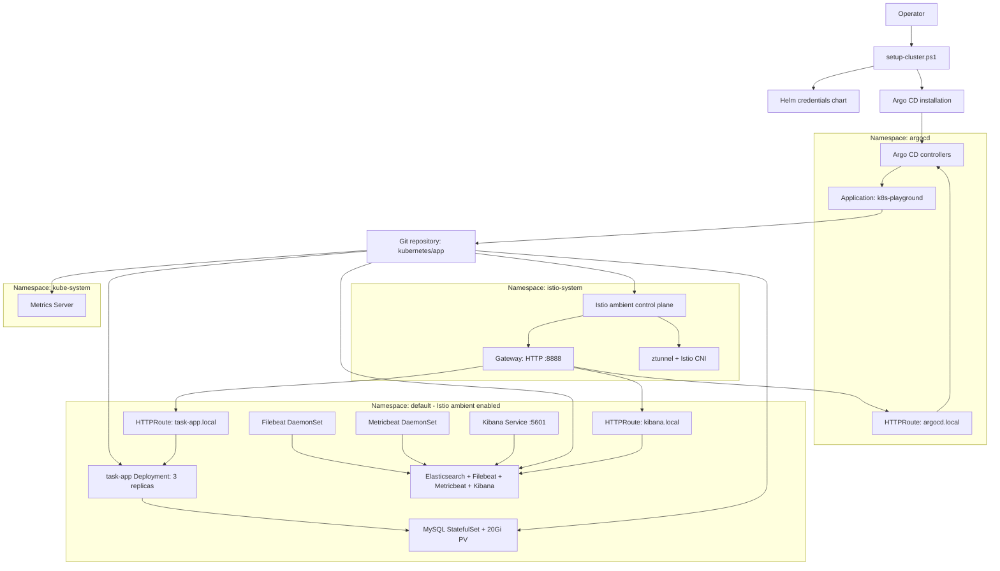

# ☸️ Local Kubernetes Playground

This repository bootstraps an existing local kind cluster created through the Docker Desktop UI with Argo CD and continuously reconciles [task-app](https://github.com/giulio-diluca/task-app), a simple Task-App CRUD REST API built with Go and the Gin Gonic framework. The platform includes a MySQL StatefulSet, Istio ambient-mode networking and Gateway API ingress, Kubernetes Metrics Server, and an Elasticsearch/Filebeat/Metricbeat/Kibana observability stack.

> **Security notice:** the manifests contain development credentials, including the database password `12345`. Replace all placeholder and default credentials before using this repository outside a disposable lab cluster. Never commit the rendered `kubernetes/credentials/values.yml` file.

## 🏗️ Architecture



Argo CD is the control plane for the application layer. `setup-cluster.ps1` performs the one-time bootstrap, then the `k8s-playground` Application watches the configured Git repository with automated sync, pruning, and self-healing enabled.

## ⚙️ Technical Stack

- Docker Desktop with a local Kubernetes cluster created with the `kind` cluster type
- Kubernetes and Helm 3
- Argo CD Application API
- Istio ambient mode 1.30.4 and Gateway API experimental CRDs
- MySQL `latest`, task-app `latest`, Elasticsearch 7.17.10, Filebeat/Metricbeat 7.17.0, and Kibana 7.17.10. MySQL and task-app image tags are currently unpinned in the Kubernetes manifests.
- Kubernetes Metrics Server 0.9.0

## 📂 Folder Structure

```text
├── setup-cluster.ps1                # PowerShell cluster bootstrap entry point
├── kubernetes/
│   ├── config/                      # Argo CD namespace, installation, root app, DB config
│   ├── credentials/                 # Helm chart for repository and registry secrets
│   └── app/                         # Argo CD-managed Kubernetes resources
│       ├── istio/                   # Ambient mesh, Gateway API, and task-app gateway
│       ├── elk/                     # Elasticsearch, Beats, and Kibana
│       └── task-app*.yaml           # Application, MySQL, storage, and policies
├── CONTRIBUTING.md
└── LICENSE.md
```

## 🚀 Quick Start

### 1. Prerequisites

The operator needs:

- Docker Desktop with a local Kubernetes cluster created from the Docker Desktop UI using the `kind` cluster type.
- `kubectl` configured. The manifests create namespaces, CRDs, ClusterRoles, ClusterRoleBindings, APIService objects, DaemonSets, PVs, and an Argo CD installation.
- Helm 3 installed and available on `PATH`.
- PowerShell 7+ installed and available on `PATH`.
- Network access from the cluster to the configured Git repository, GHCR, Docker Hub, and the container registries referenced by the manifests.
- A GitHub username and PAT with repository read access, a GHCR-capable token, and a Docker Hub access token.

Create or start the local cluster before bootstrapping:

1. Open Docker Desktop.
2. Open the Kubernetes view and choose **Create cluster**.
3. Select the `kind` cluster type and create the cluster.
4. Wait until Docker Desktop reports that the cluster is running and its Kubernetes context is available.

This repository does not create the cluster. The bootstrap scripts only install the repository resources into the already-running Docker Desktop kind cluster.

### 2. Configure credentials

Create the ignored values file from the template:

```powershell
Copy-Item kubernetes/credentials/values.yml.tmpl kubernetes/credentials/values.yml
```

Set these values in `kubernetes/credentials/values.yml`:

| Value | Purpose | Constraint |
| :--- | :--- | :--- |
| `gitRepo.url` | Git repository Argo CD watches | Must contain the `kubernetes/app` path |
| `gitRepo.username` | GitHub repository authentication | Required when the repository is private |
| `gitRepo.token` | GitHub PAT | Read-only repository access is sufficient |
| `ghcr.username` / `ghcr.password` | GHCR image pull secret | Must read `ghcr.io/giulio-diluca/task-app` |
| `dockerhub.username` / `dockerhub.password` | Docker Hub pull secret | Must pull MySQL, Elasticsearch, Kibana, and Beats images |
| `dockerhub.email` | Docker Hub secret metadata | Use the account email |

The chart creates `gh-repo-creds` in `argocd`, and `ghcr-reg-secret` plus `docker-reg-secret` in `default`. The task application reads the `db_config.yaml` key from the committed `kubernetes/app/task-app-secret.yaml` Secret, mounted at `/app/db_config.yaml`; `kubernetes/config/db_config.yaml` is the human-readable source copy and is not automatically rendered into the Secret. Update both files and the MySQL `MYSQL_ROOT_PASSWORD` together when changing the database password. For non-lab use, remove the credential from Git and provision this Secret through an external secret manager.

> **Repository check:** `kubernetes/config/application.yaml` currently points to `https://github.com/giulio-diluca/k8s_playground.git`. Change `spec.source.repoURL` to the repository containing this checkout if that URL is not the intended source before bootstrapping.

### 3. Bootstrap the cluster

```powershell
.\setup-cluster.ps1
```

Use `.\setup-cluster.ps1 -WhatIf` to print the commands without changing the cluster.

The script applies the Argo CD namespace, installs the credentials chart, applies Argo CD using server-side apply, and creates the root Application. It does not create or configure the local Docker Desktop or kind cluster.

### 4. Validate reconciliation

```powershell
kubectl get applications -n argocd
kubectl get pods -A
kubectl get gateway,httproute -n istio-system
kubectl get pvc,pv -n default
kubectl top nodes
kubectl top pods -n default
```

The expected steady state is an `Application` named `k8s-playground` with `Synced` and `Healthy` status, three `task-app` pods, one MySQL pod, one Elasticsearch pod, one Kibana pod, and one Filebeat/Metricbeat pod per cluster node.

### 5. Access the services

Docker Desktop provides a built-in load balancer for its local Kubernetes cluster. The Istio Gateway exposes all configured `.local` HTTP routes through local port `8888`; local port 80 can be occupied by other services. Add the following entries to `C:\Windows\System32\drivers\etc\hosts`:

```text
127.0.0.1 argocd.local kibana.local task-app.local
```

After the Gateway is ready, open these URLs directly in a browser:

- `http://task-app.local:8888/`
- `http://argocd.local:8888/`
- `http://kibana.local:8888/`

The routes are selected by hostname, so use the matching hostname rather than the load balancer IP alone. Verify the Gateway and its assigned address with:

```powershell
kubectl get gateway task-app-gateway -n istio-system
kubectl get svc -n istio-system
```

Kibana is also exposed as a NodePort. Use the NodePort or port-forward when the Docker Desktop load balancer is unavailable:

```powershell
kubectl port-forward svc/task-app-kibana 5601:5601 -n default
```

## 🔌 Task API

The Gateway routes HTTP traffic for `task-app.local` to the task-app Service on port 80, which forwards to the Go application on container port 8080. The application exposes the following CRUD endpoints:

| Method | Path | Body |
| :--- | :--- | :--- |
| `GET` | `/tasks` | None |
| `GET` | `/tasks/:id` | None |
| `POST` | `/tasks` | `{"Title":"string","Description":"string"}` |
| `PUT` | `/tasks/:id` | `{"Title":"string","Description":"string"}` |
| `DELETE` | `/tasks/:id` | None |

Run smoke tests through the configured Gateway:

```powershell
curl.exe -H "Host: task-app.local" http://task-app.local:8888/tasks
curl.exe -H "Host: task-app.local" -H "Content-Type: application/json" -X POST http://task-app.local:8888/tasks -d '{"Title":"test1","Description":"test1"}'
curl.exe -H "Host: task-app.local" http://task-app.local:8888/tasks/1
```

For local troubleshooting, bypass the host load balancer with a tunnel:

```powershell
kubectl port-forward svc/task-app-gateway-istio 9999:8888 -n istio-system
```

```powershell
curl.exe -H "Host: task-app.local" http://localhost:9999/tasks
```

The Istio policies permit only the Gateway service account to reach task-app on port 8080 and only the task-app service account to reach MySQL on port 3306. A temporary pod using another identity should therefore be rejected by Istio, while a TCP-only probe may still complete the initial handshake before policy evaluation.

## 📊 Observability Runbook

Application and Istio proxy logs are collected from node container logs by Filebeat and indexed in Elasticsearch. Metricbeat collects Kubernetes and container metrics; Metrics Server separately supplies short-lived `metrics.k8s.io` data for `kubectl top` and autoscaling.

### Import the pre-built Kibana assets (recommended)

`kubernetes/config/elk.ndjson` is a Saved Objects export containing the `filebeat-*` and `metricbeat-*` data views and a **Task App - Dashboard** with Response Codes, Traffic Volume & P95 Latency, Top 10 Requested URLs, Recent HTTP Errors (>= 400), and per-pod CPU/RAM panels.

1. Open Kibana at `http://kibana.local:8888/` or use the port-forward above.
2. Go to **Management > Stack Management > Saved Objects**.
3. Click **Import**, select `kubernetes/config/elk.ndjson`, and confirm.
4. Open **Dashboard > Task App - Dashboard** to view the imported visualizations.

This import creates both data views automatically, so manual data view creation (below) is only needed if the file is unavailable or you want a custom pattern.

### Manual data view creation (optional)

Open Kibana at `http://kibana.local:8888/` or use the port-forward above. In **Discover**, create or select the `filebeat-*` data view for logs and `metricbeat-*` for metrics. Useful filters include:

```text
kubernetes.namespace: "default"
kubernetes.namespace: "istio-system"
envoy.response_code >= 400
```

Inspect the request path and resource metrics with:

```powershell
kubectl logs -n istio-system -l gateway.networking.k8s.io/gateway-name=task-app-gateway --tail=50
kubectl logs -n default -l app=task-app --tail=50 --prefix
kubectl top nodes
kubectl top pods -A
```

## 🧯 Failure Recovery

| Symptom | Likely cause | Operator action |
| :--- | :--- | :--- |
| `ImagePullBackOff` for ELK pods | Registry access or Docker image pull failure | Check the Docker registry Secret, pull the referenced image manually, then recreate the affected pod and inspect `kubectl describe pod`. |
| `503`, `504`, or `connection reset` through the Gateway | Gateway route, backend readiness, ambient interception, or policy mismatch | Check `kubectl get gateway,httproute -n istio-system`, Gateway logs, task-app readiness, and `kubectl logs -n istio-system daemonset/ztunnel`. |
| task-app pods fail after database startup | MySQL is not ready or the database configuration Secret is wrong | Check `kubectl logs statefulset/task-app-sql-db`, verify `task-app-sql-db:3306` and the shared password, then wait for task-app's configured connection retries. |
| `kubectl top` reports `Metrics API not available` | Metrics Server is not ready or cannot validate the local kubelet certificate | Check `kubectl get apiservice v1beta1.metrics.k8s.io`, Metrics Server logs, and pod readiness. The local manifest uses the Docker Desktop-compatible kubelet settings. |
| Argo CD reports `OutOfSync` for Istio webhooks | Istiod changes webhook fields at runtime | Inspect the live webhook and configure Argo CD `ignoreDifferences` for controller-managed fields if the drift is expected. |
| Elasticsearch rejects events with `mapper_parsing_exception` | Log fields conflict with the ECS mapping | Keep Envoy fields under a dedicated namespace such as `envoy.*` when decoding JSON in Filebeat; avoid placing string values over ECS object fields. |

## 📋 Component & Interface Contract

| File / Component | Role / Responsibility | Key Inputs / Triggers | Outputs / Side Effects |
| :--- | :--- | :--- | :--- |
| `setup-cluster.ps1` | PowerShell cluster bootstrap | `kubectl`, Helm, configured context | Argo CD and root Application |
| `kubernetes/credentials` | Helm chart for credentials | `values.yml` | Repository and registry Secrets |
| `config/application.yaml` | Argo CD source and sync policy | Git URL and `kubernetes/app` path | Automated sync, prune, and self-heal |
| `kubernetes/app/task-app-deployment.yaml` | Deployment of the [task-app](https://github.com/giulio-diluca/task-app) Go/Gin CRUD REST API | GHCR image, `task-app-secret` | 3 replicas and `task-app:80` Service |
| `kubernetes/app/task-app-sql-db-statefulset.yaml` | MySQL workload and schema init | `MYSQL_ROOT_PASSWORD`, `task_app` database | MySQL at `task-app-sql-db:3306` |
| `kubernetes/app/task-app-sql-db-pv.yaml` | MySQL persistent storage | Node path `/var/tmp/mysql-data` | 20Gi `ReadWriteOnce` PV/PVC |
| `kubernetes/app/istio` | Ambient mesh, mTLS dataplane, gateway | Istio CRDs, CNI, ztunnel, Gateway API CRDs | L4 authorization and HTTP routing |
| `kubernetes/app/k8s-metric-servers.yaml` | Kubernetes resource metrics | Kubelet metrics endpoint | `metrics.k8s.io` API and `kubectl top` |
| `kubernetes/app/elk` | Logs, cluster metrics, and UI | Elasticsearch service and host log/proc mounts | Elasticsearch `:9200`, Kibana NodePort `:30001` |
| `kubernetes/config/elk.ndjson` | Kibana Saved Objects export | Manual import via Stack Management > Saved Objects | `filebeat-*`/`metricbeat-*` data views and Task App - Dashboard |

## 🔐 Configuration, RBAC & Dependencies

### Runtime configuration

| Configuration | Current value | Used by |
| :--- | :--- | :--- |
| Database host | `task-app-sql-db:3306` | `task-app` |
| Database | `task_app` | MySQL and `db_config.yaml` |
| Database pool | 25 open, 10 idle connections | `task-app` |
| Database retries | 10 retries, 5 seconds delay | `task-app` |
| Task image | `ghcr.io/giulio-diluca/task-app:latest` | Task-app Deployment |
| Kibana | `task-app-kibana:5601` / NodePort `30001` | Kibana Service and Filebeat |
| Elasticsearch | `task-app-elasticsearch:9200` | Kibana, Filebeat, Metricbeat |
| MySQL storage | 20Gi at `/var/tmp/mysql-data` | MySQL PV |
| Elasticsearch storage | 5Gi PVC using the cluster default StorageClass | Elasticsearch StatefulSet |

### Permissions and security boundaries

- The bootstrap identity requires cluster-admin-equivalent access because it installs Argo CD CRDs and cluster-scoped RBAC.
- Argo CD needs read access to the configured Git repository and Kubernetes permissions to reconcile every resource under `kubernetes/app`.
- Filebeat reads pod, node, and namespace metadata and host container logs. Metricbeat reads node, pod, workload, kubelet, and `/proc`/`/sys` data through dedicated ClusterRoles.
- Istio AuthorizationPolicies only allow the gateway service account to reach task-app port 8080 and the task-app service account to reach MySQL port 3306.
- Registry and Git credentials are Kubernetes Secrets. They are base64-encoded, not encrypted, in the rendered manifests; use an external secret manager for sensitive environments.

## 🤝 Contributing

Use a feature branch and pull request as described in [CONTRIBUTING.md](CONTRIBUTING.md). Keep credentials out of Git and validate manifests against a disposable cluster before opening a pull request.

## 📄 License

This project is distributed under the [MIT License](LICENSE.md).
